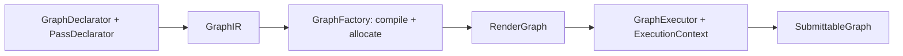

# About

Caldera is my pet project. The user declares passes and what they read and 
write. Based on it, Caldera provides pass order, transient resources and 
barriers

Current aims:
- Make a basic pipeline of graph creating:
    Declare → Create → Execute
- Colored triangle through render graph with no validation errors

Deferred aims:
- Swapchain images support
- Memory aliasing
- Multi-threading queue writing
- Pass batching

# Contents

- [Overview](#overview)
    - [Glossary](#glossary)
    - [Design principles](#design-principles)
- [Graph declaration](#graph-declaration)
    - [Resources](#resources)
    - [Passes](#passes)
    - [Versions](#versions)
- [Intermediate Representation](#intermediate-representation)
- [Graph Creation](#graph-creation)
- [RenderGraph](#rendergraph)
- [Synchronization](#synchronization)
- [Graph execution](#graph-execution)
- [Decisions](#decisions)
- [Open questions](#open-questions)

# Overview

The graph of program data flow:

## Glossary
- `GraphDeclarator` declares resources and passes used in graph
- `PassDeclarator` declares pass and what it reads and writes
- `GraphIR` is a baked formatted representation of user declarations
- `RenderGraph` stores passes, allocated resources and compiled barriers for them
- `SubmittableGraph` is a ready-to-submit data from a graph
- `ExecutionContext` is a storage of references to objects that are needed for
  execution
- `ResourceMap` maps resource ids to its handles
- `ResourceStateManager` stores resource previous states
- `CommandBufferDistributor` provides command buffers for certain families
- `GraphFactory` creates RAII classes of `RenderGraph`
- `GraphRequirements` include required release-barrier pushed by user before
  execution of a graph
- _version_ is an info about resource one writing and many readings
- _origin offset_ is an ordinal number for an executed pass

## Design principles
- Nothrow context
- std::expected for error handling
- No allocations during graph execution
- Cache-friendly structs
- Error handling: there are 2 types of errors: user errors and
  environment errors. User errors are handled only in Debug builds via
  assert. Env errors are handled with std::expected return values
- Basic code is in .cpp files, but hot and template methods and functions
  are written in .hpp files
- Minimum usage of PIMPL pattern

# Graph declaration

## Resources
- For identifying resources, I use the `ImageID` or `BufferID` types
- There are two types of resources: `transient` and `presistent`
- Transient resources exist only in a graph. They are declared in
  `GraphDeclarator` during the declaration phase
- Persistent resources exist outside a graph and are managed by the user.
  They are declared in `ResourceMap` during the whole program

## Passes

- For declaring passes I use the `PassDeclarator` type. It is used to
  declare what the pass reads and writes. It also declares the pass type,
- There are pass types: `graphics`, `compute`, `transfer`

## Versions

A version of resource is a struct of:
- Info about the pass that creates this version (writes the resource) and about
  the way how pass writes the resources
- LIST of infos about passes that read the data produced by writer and about
  the way how passes read the updated resource

Each resource object has its own list of versions. The first version is always
external. For persistent resources, this version means that resource was
written externally. For transient one, it means undefined initial state.

Compiler makes the dependency tree basing on list of versions.

The `read_write` access is allowed.

The situation when a pass reads a resource more than one time by different
ways is not allowed (at least now)

Resource touch is described with:
- Access flags
- Stage mask
- Family type/index
- Subresource range
- Layout (for images only)

# Intermediate Representation

`GraphIR` is a struct of all data compiler and allocator need to compile and
allocate a graph. It includes:

- List of transient resource create infos
- List of resource versions
- List of pass infos, that include:
    - Pass name
    - Pass type
    - Callback

Here, versions are single source of truth

# Graph Creation

To create a graph, the user should make some steps:
1. Take the `GraphIR` from `GraphDecarator`
2. Create a graph with `GraphFactory` and `GraphIR`

To create a `RenderGraph`, `GraphFactory` requires:
- VkDevice handle
- VmaAllocator handle
- Indices of **graphics**, **transfer**, and **compute** families

# RenderGraph

The `RenderGraph` class is split to a few different modules:
- `GraphResoures` - it contains all transient resources and all information
  about resources of any type.
- `GraphPasses` - it contains all passes and all
  information about passes of any type.

`GraphResources` contains:
- list of transient images and buffers
- list of resource allocations
- list of tracked usages of each resource. Tracked usage info includes:
    - resource first usage in this graph (to make a barrier from prev state)
    - resource last usage in this graph (to push it to `ResourceStateManager`)
    - resource usage flags (for check if `ResourceMap`'s resource is compatible)
    - only for images, aspect mask (for making vk barrier from a template)

`GraphPasses` contains:
- list of pass descriptions, that include:
    - pass name (for vk debug utils)
    - callback (for execution)
    - list of used resources (for a filter for `ResourceMap`)
    - list of resource barriers of this pass (for execution)
    - list of pass indices the current pass depend on (for semaphore submissions)
- list of pass order indices (result of topological sort)

# Synchronization

- Barriers of resource transitions INSIDE the graph are generated
at the graph compilation

- Barriers of persistent resource INITIAL transitions are generated 
dynamically during graph execution. This is because persistent resources
can be used in multiple graphs and their state is unknown at graph 
compilation time. Resource states are tracked by `ResourceStateManager`

- In-graph barriers are generated as a template for `vk` barriers. The
barrier templates stores resource ID, not its handle because the
handles of persistent resources (transient MAY be known)
are unknown at graph compilation time

- When the user creates a graph, he passes the vk::Device handle and indices of
families to the function. Then all passes get its family index that is mapped
to enumeration `FamilyType` (the pass type)

- Cross-graph accesses are combined in `ResourceStateManager`. When the first pass
touches a persistent resource, barrier for it is written in this pass. When this
pass touches a transient resource, barrier from undefined state is written in
this pass

- The first-touch barrier for a persistent resource MAY be of
ownership-acquisition. To keep the release barrier, each graph has the special
properties names `GraphRequirements`. In that class, all release-barriers for
an external code are specified. The `GraphRequirements` class is also may be
an option for graph execution and show for the graph, in what state the executor
should transit the resource after the whole execution

- Origin offset is an ordinal number of an executed pass. Based on it and
going with it stage mask, the user can create timeline value of a semaphore
to wait.

- `ResourceStateManager` get a new resource state updates after the whole
execution of the graph. The state to record is stored in tracked infos as
_lastTouch_

# Graph execution

The final result of execution is `SubmitableGraph` struct. It is a struct of:

- list of executed passes. Each pass has:
  - family index of queue the pass should be submitted to
  - current pass origin offset
  - written command buffer
  - list of `PassDependency` (a pair of origin offset of pass to wait and 
      stage mask)

Firstly, the user should make `ExecutionContext`. It is a simple struct with
references to the resources executions are based on. It includes:

- `ResourceMap` - to map persistent resources
- `ResourceStateManager` - to get resource prev state for in-barriers generating
- `CommandBufferDistributor` - class that gives command buffers for passes

# Decisions

- In `GraphFactory`, Graph allocation goes AFTER compilation
- Versions are the single source of dependencies
- Persistent resource in-barriers are generated at execution
- Removed `SemaphoreMap` class
- Render Graph Cycle is a user error so it is handled in Debug builds only 
- `GraphRequirements` is an output property of created `RenderGraph`
- (1) Use basic ID (with no mip levels and array layers)

# Open questions

- Subresource Range and simple versioning occurs to false pass dependencies.
Should I make an opaque resource ID with mip levels and array layers? So the 
handle is appended with 8 bits of mip levels (15 mip levels is max so 4 bits
2 times for base level and count) and 24 bits of array layers (4096 max, 12
bits 2 times). So handle gets extra 4 bytes. **DECISION: (1)**